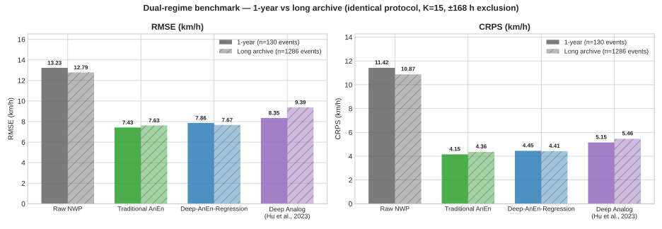
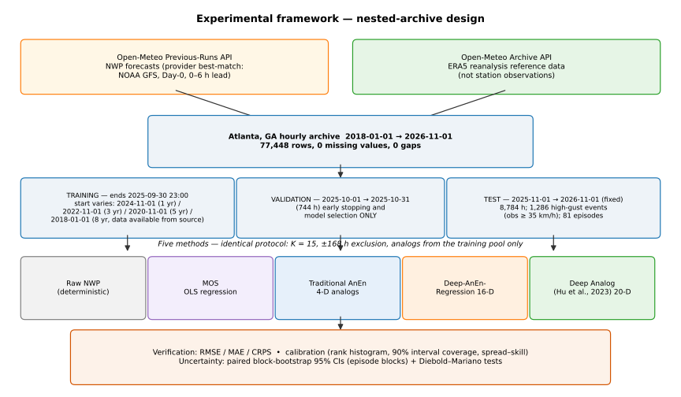
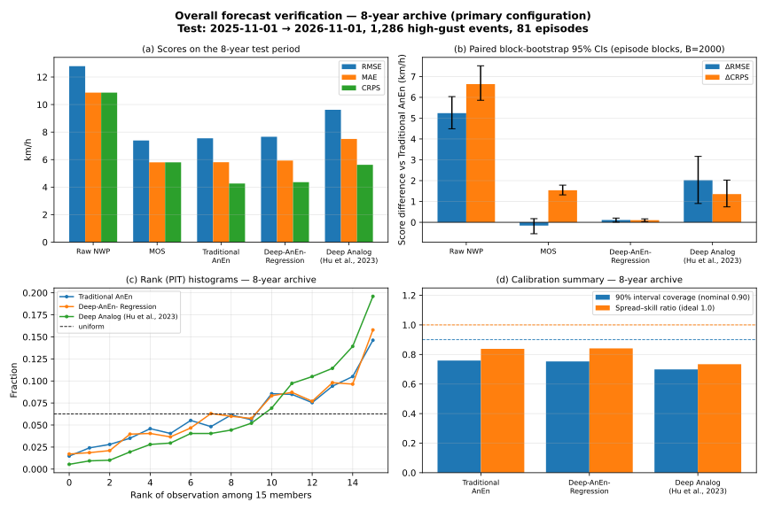
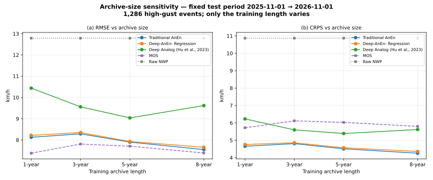
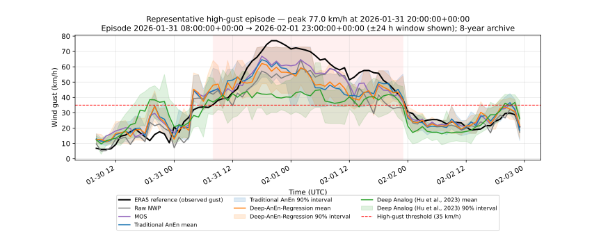
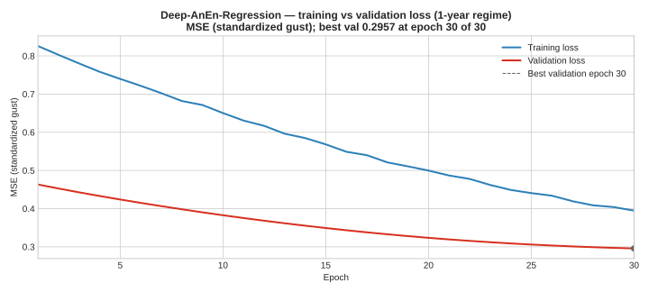
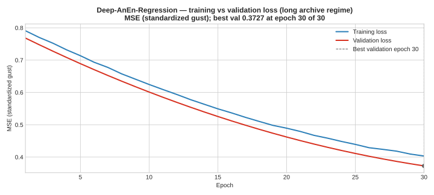
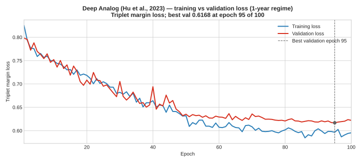
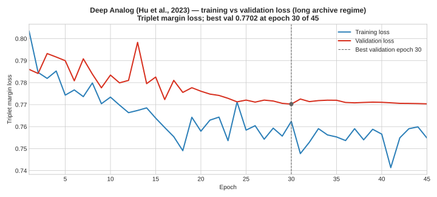

# ML Analog Ensemble for Severe-Weather Gust Forecasting

**Question.** Can analog-ensemble methods beat raw numerical weather prediction (NWP) for forecasting severe wind gusts, and does a learned similarity space help when the archive gets longer? **Answer.** Yes to the first — every analog method beats raw NWP by a wide margin in both regimes — and no, not as configured, to the second: the simplest 4-D analog search stays best, and the learned spaces do not overtake it even on 8 years 10 months of data.

## Dataset

Hourly data for Atlanta, GA (33.64, −84.42), built from two Open-Meteo sources: **forecasts** from the Previous-Runs API (historical NWP forecasts) and **observations** from the Archive API (ERA5). Four forecast predictors — temperature, wind speed, gust, surface pressure — and the observed gust (`obs_gust`) as the target. The archive starts **2018-01-01**: the Previous-Runs API returns no valid forecast data earlier (verified by probe, 2026-11-09), so 2018-01-01 is the earliest usable date.

The long archive is stored as **yearly files** because the combined 7.15 MB file exceeded the GitHub snapshot upload size limit; concatenating them reproduces it exactly. The 1-year file is `data/atlanta_weather_archive_1yr.csv`.

**NWP identity.** The Previous-Runs requests pass no `models` parameter, so the provider default (auto / best-match) applies; empirically the returned series is identical to NOAA GFS (seamless) at sampled windows in 2018, 2021, 2023 and 2025. The plain variables are the Day-0 offset — the forecast from the most recent model run before the valid hour (GFS updates every 6 h, so the effective lead time is 0–6 h); valid time is the hourly UTC timestamp. The endpoint exposes no per-hour model attribution or run-initialisation field. **Reference data are ERA5 reanalysis** (Archive API), not independent station observations — verification is against reanalysis (see the limitations note in `notebooks/nested_archive_analysis.ipynb`). **No values are interpolated:** a re-fetch of the full window with a fresh cache and no interpolation returned 0 NaN cells in any column, identical to the files in use, so the old interpolate/ffill/bfill calls were a no-op and have been removed from `fetch_data.py` (missing rows are now dropped instead).

| File | Date range | Rows |
|---|---|---|
| `data/atlanta_weather_archive_1yr.csv` | 2025-11-02 – 2026-11-01 | 8,760 |
| `data/atlanta_weather_archive_2018.csv` | 2018-01-01 – 2018-12-31 | 8,760 |
| `data/atlanta_weather_archive_2019.csv` | 2019-01-01 – 2019-12-31 | 8,760 |
| `data/atlanta_weather_archive_2020.csv` | 2020-01-01 – 2020-12-31 | 8,784 |
| `data/atlanta_weather_archive_2021.csv` | 2021-01-01 – 2021-12-31 | 8,760 |
| `data/atlanta_weather_archive_2022.csv` | 2022-01-01 – 2022-12-31 | 8,760 |
| `data/atlanta_weather_archive_2023.csv` | 2023-01-01 – 2023-12-31 | 8,760 |
| `data/atlanta_weather_archive_2024.csv` | 2024-01-01 – 2024-12-31 | 8,784 |
| `data/atlanta_weather_archive_2025.csv` | 2025-01-01 – 2025-12-31 | 8,760 |
| `data/atlanta_weather_archive_2026.csv` | 2026-01-01 – 2026-11-01 | 7,320 |

## Regimes

- **1-year:** 2025-11-02 to 2026-11-01 (8,760 rows). Train ≤ 2026-08-15 (6,888 rows), validation to 2026-08-31 (384), test ≥ 2026-09-01 (1,488). **130 test storm events** (observed gust ≥ 35 km/h).
- **8 years 10 months:** 2018-01-01 to 2026-11-01 (77,448 rows). Train 2018-01-01 to 2024-11-01 (59,928 rows), validation 1 year (8,760), test 1 year (8,760). **1,286 test storm events.**

`_8yr10mo` = 8 years 10 months. All splits are strictly chronological; analogs are drawn from the training pool only, with a ±168 h (±7-day) exclusion around each target.

## Methods

- **Raw NWP** — the forecast gust as issued, no correction.
- **MOS** — Model Output Statistics: OLS regression of observed gust on the four standardized forecast predictors, fitted on training data only (deterministic; CRPS = MAE).
- **Traditional AnEn** — analog search in the 4-D standardized predictor space (K = 15).
- **Deep-AnEn-Regression** — a 4→32→16 MLP embeds forecasts into a 16-D latent space; analogs are retrieved there (K = 15).
- **Deep Analog (Hu et al., 2023)** — a 3-layer LSTM embeds 24-hour forecast sequences into a 20-D space learned with a triplet network (K = 15).

## Results

RMSE and CRPS (km/h) on the test storm events. Diebold–Mariano p-values are against Traditional AnEn (p < 0.05 = significant). The long regime is the 8-year 10-month archive (2018–2026); table headers abbreviate it as "8yr 10mo".

| Method | 1-yr RMSE | 1-yr CRPS | 1-yr DM p | 8yr 10mo RMSE | 8yr 10mo CRPS | 8yr 10mo DM p |
|---|---:|---:|---:|---:|---:|---:|
| Raw NWP | 13.23 | 11.42 | 5.6×10⁻¹⁰ | 12.79 | 10.87 | < 0.001 |
| Traditional AnEn | 7.43 | 4.15 | — | 7.63 | 4.36 | — |
| Deep-AnEn-Regression | 7.86 | 4.45 | 0.035 | 7.67 | 4.41 | 0.227 |
| Deep Analog (Hu et al., 2023) | 8.35 | 5.15 | 0.029 | 9.39 | 5.46 | 7.0×10⁻⁶ |

**Two findings.** First, Deep-AnEn-Regression **caught up** on the long archive: its gap to Traditional AnEn shrank from 0.43 to 0.04 km/h RMSE and the difference is no longer significant (p = 0.227) — the two are statistically tied. Second, the ordering **persisted**: skill falls as the similarity space grows, 4-D > 16-D > 20-D, and the triplet model's gap to Traditional widened (0.92 → 1.76 km/h RMSE, p = 7.0×10⁻⁶). The earlier prediction that a longer archive would narrow or reverse the ordering is falsified for the triplet model as configured — its validation loss barely improved on the long run, so the configuration, not data volume, looks like the binding constraint. This matches Platzer et al. (2024): the optimal analog distance depends on data volume, and a reduced feature space preserves analog performance on small-to-medium archives. The same pattern holds when the long-trained models are scored on the exact 130 1-year events (Traditional 7.02, Regression 7.10, Deep Analog 8.31 km/h RMSE).

Verification: the comparison notebook audits both regimes — 5,850 (1-year) and 57,870 (long) analog selections, all six checks passed (identical training pool, ±168 h exclusion, members equal to training observations, identical scalers, saved metrics reproduce exactly).




## Nested-archive experiment (reviewer revision)

The 1-year vs 8-years-10-months comparison changed the test period along with the training archive, so archive size and test difficulty were confounded. The nested experiment fixes the test period (2025-11-01 → 2026-11-01; 1,286 high-gust events, 81 independent episodes) and the validation period (Oct 2025) for all four archives and varies only the training length (1 / 3 / 5 / 8 years, identical cutoff 2025-09-30). The 8-year archive uses the forecast data available from the source, beginning 1 January 2018. Details, calibration, bootstrap CIs and the audit: `notebooks/nested_archive_analysis.ipynb`.

| Method | 1-yr RMSE | 1-yr CRPS | 3-yr RMSE | 3-yr CRPS | 5-yr RMSE | 5-yr CRPS | 8-yr RMSE | 8-yr CRPS |
|---|---:|---:|---:|---:|---:|---:|---:|---:|
| Raw NWP | 12.79 | 10.87 | 12.79 | 10.87 | 12.79 | 10.87 | 12.79 | 10.87 |
| MOS | 7.38 | 5.72 | 7.81 | 6.12 | 7.71 | 6.03 | 7.39 | 5.80 |
| Traditional AnEn | 8.13 | 4.66 | 8.29 | 4.81 | 7.90 | 4.51 | 7.55 | 4.26 |
| Deep-AnEn-Regression | 8.22 | 4.76 | 8.35 | 4.86 | 7.93 | 4.57 | 7.66 | 4.36 |
| Deep Analog (Hu et al., 2023) | 10.44 | 6.23 | 9.56 | 5.60 | 9.04 | 5.39 | 9.62 | 5.62 |

**Findings (8-year archive is the primary configuration; differences vs Traditional AnEn use paired block-bootstrap 95% CIs over the 81 episode blocks, plus Diebold–Mariano tests).** MOS matches or beats Traditional AnEn on RMSE at every archive — significantly better at 1 and 3 years (DM p = 0.0009, 0.037), tied at 5 and 8 years — but its CRPS is far worse (+1.07 to +1.54 km/h) because it is deterministic: the analog ensembles win on probabilistic skill. Deep-AnEn-Regression is tied with Traditional at 3 and 5 years and significantly worse at 1 and 8 years (DM p = 0.014, 0.023; 8-year bootstrap dRMSE +0.11 [+0.01, +0.20]). Deep Analog is significantly worse than Traditional on every archive (DM p ≤ 0.004; 8-year dRMSE +2.02 [+0.90, +3.16]) and non-monotonic in archive size (9.04 at 5 years, 9.62 at 8 years). Archive size does not help monotonically in general: Traditional and Regression are worse at 3 years than at 1 year (8.29 vs 8.13; 8.35 vs 8.22). On the representative episode (peak 77.0 km/h, 2026-01-31) the Deep Analog ensemble mean never exceeds 45 km/h while observations reach 77 — the learned embedding does not retrieve truly extreme analogs. **Calibration:** all three ensembles are under-dispersive (90% interval coverage 0.70–0.76 vs nominal 0.90; spread–skill 0.73–0.84); rank histograms pile up at the top rank, i.e. observations frequently exceed all 15 members.









## Training vs validation loss

Overfitting would show as a training loss that keeps falling while the validation loss turns up and diverges. None of the four curves shows that: in every case the validation loss falls alongside the training loss and the final train–validation gap is small (under ~0.1). The regression curves end with validation below training loss — the standard dropout artefact, not a sign of anything wrong. Traditional AnEn has no loss curve, by design: it is non-parametric, with no learned parameters and nothing to overfit in the neural sense.

**Deep-AnEn-Regression, 1-year (30 epochs):**



**Deep-AnEn-Regression, 8 years 10 months (30 epochs):**



**Deep Analog (Hu et al., 2023), 1-year (100 epochs):**



**Deep Analog (Hu et al., 2023), 8 years 10 months (100 epochs max, early stop at 45):**



## How to reproduce

```bash
python fetch_data.py                  # 1-year archive (2025-11-02 – 2026-11-01)
python fetch_data.py --long-archive   # 8 years 10 months archive, yearly files
python build_comparison_notebook.py   # rebuild notebooks/comparison_analysis.ipynb
python -m nbconvert --to notebook --execute --inplace notebooks/comparison_analysis.ipynb
```

The notebook re-runs all four methods from the saved checkpoints and re-verifies both audits; no retraining is needed. PNG figures and `.pth` weights are committed in local git only — the GitHub snapshot connector is text-only — so the repo carries SVG figures and JSON state dicts instead; running the notebook regenerates the PNGs and `.pth` files locally.

Nested-archive experiment (reviewer revision):

```bash
python mos_baseline.py                                     # MOS baseline, all 4 archives
python train_regression_nested.py                          # Deep-AnEn-Regression retrains
python traditional_anen.py --regime nested_8yr             # (etc. per archive)
python phase4_triplet.py --regime nested_8yr --resume       # Deep Analog retrain
python nested_episode_forecasts.py                         # Fig 4 episode forecasts
python nested_analysis.py                                  # scores, calibration, bootstrap, DM
python nested_tables.py                                    # Tables 1-2
python plot_nested_figures.py                              # Figs 1-4
python build_nested_notebook.py                            # rebuild notebooks/nested_archive_analysis.ipynb
python -m nbconvert --to notebook --execute --inplace notebooks/nested_archive_analysis.ipynb
```

## Project structure

```
├── data/                               # yearly CSVs (see Dataset table)
├── notebooks/
│   ├── deep_anen_severe_weather.ipynb  # Phase 2: train Deep-AnEn-Regression
│   ├── comparison_analysis.ipynb       # 4-way comparison, audits, DM tests
│   └── nested_archive_analysis.ipynb   # Phase B: nested-archive experiment
├── metrics/                            # saved metrics (JSON; _8yr10mo = long regime; nested_* = Phase B)
├── models/                             # checkpoints (.pth local only; .json on GitHub)
├── plots/                              # figures (SVG on GitHub; PNG local only)
├── data_prep.py                        # shared protocol: splits, scaler, events, episodes
├── fetch_data.py                       # Open-Meteo data pipeline
├── traditional_anen.py                 # Traditional AnEn engine (K=15)
├── phase4_triplet.py                   # Deep Analog (Hu et al., 2023), LSTM + triplets (+ --resume)
├── train_regression_long.py            # Deep-AnEn-Regression retrain (long regime)
├── train_regression_nested.py          # Deep-AnEn-Regression retrains (nested archives)
├── mos_baseline.py                     # MOS baseline (OLS, nested archives)
├── nested_analysis.py                  # nested scores, calibration, bootstrap CIs, DM tests
├── nested_tables.py                    # nested Tables 1-2
├── nested_episode_forecasts.py         # Fig 4 episode forecasts
├── plot_nested_figures.py              # nested Figs 1-4
├── build_nested_notebook.py            # builds the nested notebook
├── dm_tests.py                         # Diebold–Mariano tests, both regimes
├── plot_loss_curves.py                 # training-vs-validation loss figures
├── build_comparison_notebook.py        # builds the comparison notebook
└── README.md
```

## References

- Delle Monache, L., et al. (2011). *Probabilistic Weather Prediction with an Analog Ensemble.* Monthly Weather Review, 139(11).
- Delle Monache, L., et al. (2013). *An Analog Ensemble for NWP Post-Processing.* Monthly Weather Review, 141(11).
- Hu, W., Cervone, G., Young, G., et al. (2023). *Machine Learning Weather Analogs for Near-Surface Variables.* Boundary-Layer Meteorology, 186, 711–735. https://doi.org/10.1007/s10546-022-00779-6 — official implementation: https://github.com/uga-gaim/DeepAnalog
- Platzer, P., et al. (2024). *Distance Learning for Analog Methods.* HAL-04841334.
- Diebold, F. X., & Mariano, R. S. (1995). *Comparing Predictive Accuracy.* Journal of Business & Economic Statistics, 13(3), 253–263.
- Open-Meteo: https://open-meteo.com/ (Previous-Runs & Archive APIs)

## License

MIT — see `LICENSE` when added.
