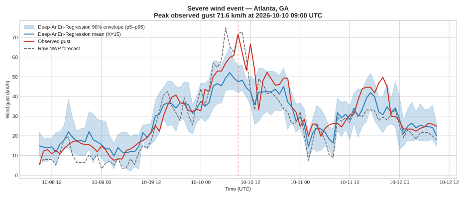
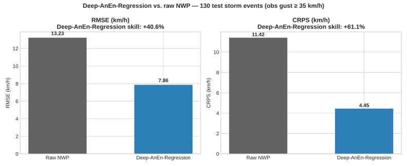
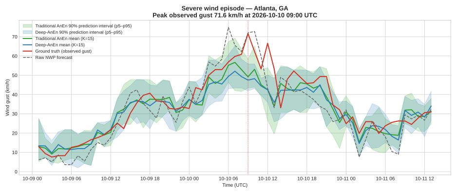
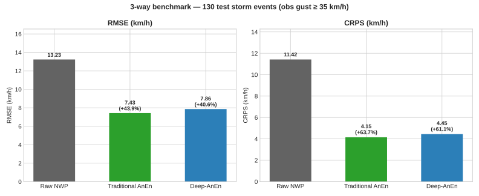
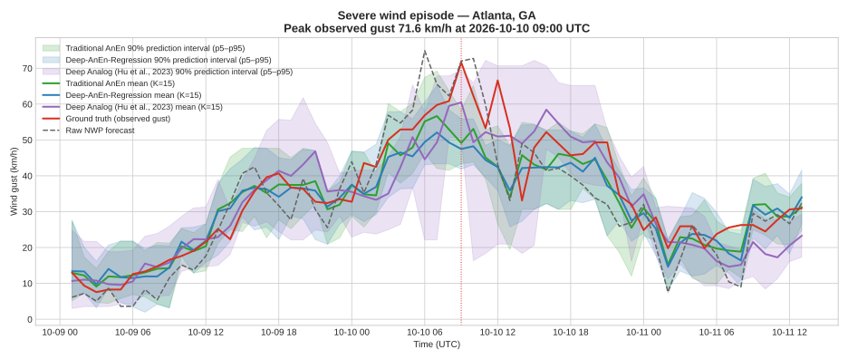
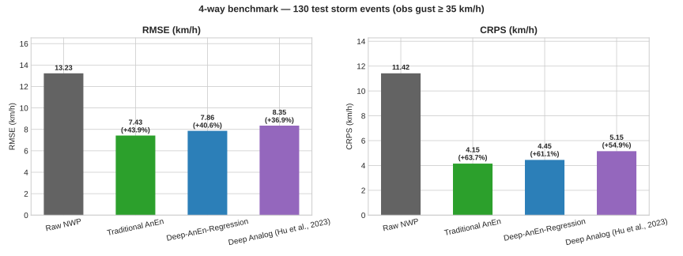

# ML Analog Ensemble for Severe Weather

**Phase 1 — NWP post-processing with the Analog Ensemble (AnEn) method**

A complete, reproducible pipeline that pairs archived numerical weather
prediction (NWP) forecasts with ground observations for Atlanta, GA, and
implements a basic Analog Ensemble search engine that converts a single
deterministic forecast into a calibrated probabilistic ensemble.

---

## Project Overview

Deterministic NWP forecasts are sharp but biased: they systematically
under-predict extreme events such as severe wind gusts. The Analog
Ensemble (AnEn) corrects this by searching a historical archive for past
forecasts that closely resemble the current one and using the *observed*
weather at those analog times as an ensemble. No model retraining is
required — the archive itself is the statistical model.

This repository (Phase 1) delivers:

- **Data pipeline** (`fetch_data.py`) — pulls 365 days of hourly NWP
  forecasts and ERA5 observations for Atlanta, GA from Open-Meteo and
  aligns them into a single clean archive.
- **Analog Ensemble engine** (`analog_ensemble.py`) — standardized
  feature search with a 7-day leakage-exclusion window, returning
  ensemble mean, median, and 10th/90th percentile predictions.
- **Pipeline runner** (`run_pipeline.py`) — end-to-end verification on
  a real severe-weather case (the peak observed wind gust in the
  archive).

## Methodology: Analog Ensemble for NWP Post-Processing

The method follows Delle Monache et al. (2011, 2013). For a target time
*t* with forecast feature vector

$$v(t) = [\text{temp}_{2m},\ \text{wind}_{10m},\ \text{gust}_{10m},\ \text{pressure}_{sfc}]$$

the engine:

1. **Extracts** the forecast vector at *t*.
2. **Excludes** a ±7-day window around *t* from the search archive so
   the target's own weather cannot leak into its analogs.
3. **Standardizes** all forecast features with `StandardScaler`, so
   variables with different units contribute comparably.
4. **Computes** the normalized Euclidean distance between *v(t)* and
   every remaining historical forecast vector.
5. **Selects** the *K* = 10 closest historical timestamps.
6. **Builds the ensemble** from the *observed* values at those analog
   times and reports the ensemble mean, median, 10th and 90th
   percentiles — a calibrated probabilistic forecast for each variable.

**Phase 1 verification (peak-gust case, 2026-01-31 20:00 UTC):**

| | Gust (km/h) |
|---|---|
| Raw NWP forecast | 52.9 |
| Observed | 77.0 |
| AnEn ensemble mean | 54.6 |
| AnEn 10th–90th percentile | 47.4 – 68.8 |

The raw forecast under-predicted the extreme gust by ~24 km/h. The
ensemble mean shows the same direction of bias (expected at K=10 in a
one-year archive), while the 90th percentile (68.8 km/h) moves
substantially toward the observed extreme — the expected signature of a
probabilistic correction. Extending the archive, tuning K, and adding
predictor variables are Phase 2 work.

## Dataset Details

| | |
|---|---|
| **Location** | Atlanta, GA — 33.64° N, 84.42° W |
| **Period** | 2025-11-02 → 2026-11-01 (365 days, hourly, UTC) |
| **Rows** | 8,760 (complete — no missing values after cleaning) |
| **Forecast source** | Open-Meteo Previous-Runs API (archived NWP forecasts) |
| **Observation source** | Open-Meteo Archive API (ERA5 reanalysis) |
| **File** | `data/atlanta_weather_archive.csv` |

Columns:

| Column | Description | Unit |
|---|---|---|
| `timestamp` | Hourly UTC timestamp | — |
| `fcst_temp` / `obs_temp` | Temperature at 2 m | °C |
| `fcst_wind` / `obs_wind` | Wind speed at 10 m | km/h |
| `fcst_gust` / `obs_gust` | Wind gusts at 10 m | km/h |
| `fcst_press` / `obs_press` | Surface pressure | hPa |

Cleaning: short gaps (≤3 h) are linearly interpolated in time with
forward/backward fill; any remaining NaNs are dropped. The fetched
archive required no row drops.

## Quickstart Guide

### 1. Clone and install

```bash
git clone https://github.com/Mahinul372/ML-Analog-Ensemble-Severe-Weather.git
cd ML-Analog-Ensemble-Severe-Weather
python -m venv .venv
source .venv/bin/activate
pip install -r requirements.txt
```

### 2. Run the full pipeline

```bash
python run_pipeline.py
```

This re-fetches the 365-day archive from Open-Meteo, rebuilds the
engine, and runs the peak-gust test case, printing forecast vs.
observation vs. ensemble metrics.

To reuse the shipped CSV without re-fetching:

```bash
python run_pipeline.py --skip-fetch
```

### 3. Use the engine in your own code

```python
import pandas as pd
from analog_ensemble import AnalogEnsembleEngine

df = pd.read_csv("data/atlanta_weather_archive.csv", parse_dates=["timestamp"])
engine = AnalogEnsembleEngine(df)

result = engine.find_analogs("2026-01-31 20:00:00+00:00", K=10)
print(result["ensemble_mean"])    # mean observed values at analog times
print(result["p10"], result["p90"])
print(result["analogs"])          # the 10 closest historical timestamps
```

### Project structure

```
├── data/
│   └── atlanta_weather_archive.csv   # 8,760 hourly rows, Atlanta GA
├── notebooks/
│   ├── deep_anen_severe_weather.ipynb  # Phase 2 Colab notebook (GPU)
│   └── comparison_analysis.ipynb       # Phase 4 4-way benchmark
├── models/
│   ├── deep_anen_regression_weights.pth         # Phase 2 encoder weights
│   ├── deep_anen_regression_weights.json        # text-safe state dict
│   ├── deep_anen_triplet_weights.pth            # Phase 4 LSTM weights
│   └── deep_anen_triplet_weights.json           # text-safe state dict
├── plots/
│   ├── fig1_event_timeseries.png/.svg
│   ├── fig2_metrics_bars.png/.svg
│   ├── 3way_method_comparison_timeseries.png/.svg
│   ├── rmse_crps_benchmark_barchart.png/.svg
│   ├── 4way_method_comparison_timeseries.png/.svg
│   └── rmse_crps_benchmark_barchart_4way.png/.svg
├── metrics/
│   ├── deep_anen_regression_metrics.json
│   ├── traditional_anen_metrics.json
│   ├── deep_anen_triplet_metrics.json
│   └── comparison_metrics.json
├── data_prep.py                      # shared protocol: split/scaler/events
├── traditional_anen.py               # Traditional AnEn engine (K=15)
├── phase4_triplet.py                 # Hu et al. (2023) Deep Analog (LSTM + RA triplets)
├── fetch_data.py                     # Open-Meteo data pipeline
├── analog_ensemble.py                # AnalogEnsembleEngine (K=10)
├── run_pipeline.py                   # end-to-end runner + verification
├── requirements.txt
└── README.md
```

### Run the Phase 2 notebook

Open
[`notebooks/deep_anen_severe_weather.ipynb`](notebooks/deep_anen_severe_weather.ipynb)
in Google Colab, select a GPU runtime (*Runtime → Change runtime type →
T4 GPU*), then *Run all*. It trains the encoder (30 epochs), evaluates on
130 test storm events, and regenerates the figures, weights, and metrics.

## Phase 2 — Deep Analog Ensemble (Deep-AnEn-Regression)

**Executive summary.** Phase 1 searched for analogs in standardized *raw*
feature space. Phase 2 learns the similarity metric: a PyTorch encoder maps
the 4-D forecast vector into a 16-D latent space trained (30 epochs, MSE,
Adam) to predict observed wind gusts, and analog search runs in that learned
space. On 130 held-out test storm events (observed gust ≥ 35 km/h,
2026-09-01 → 2026-11-01), Deep-AnEn-Regression cuts gust RMSE by **40.6%** and CRPS by
**61.1%** versus raw NWP. Full runnable notebook:
[`notebooks/deep_anen_severe_weather.ipynb`](notebooks/deep_anen_severe_weather.ipynb)
(Google Colab, GPU runtime).

**Model structure — `DeepAnalogRegressionEncoder`:**

```
forecast (4) ──▶ Linear(4 → 32) ──▶ ReLU ──▶ Dropout(0.2)
             ──▶ Linear(32 → 16) ──▶ latent embedding z (16-D)
z ──▶ Linear(16 → 1) ──▶ predicted standardized gust (training head only)
```

Analog search: encode the target forecast to `z`, exclude a ±7-day window,
take the K = 15 nearest training-period embeddings (Euclidean), and build
the ensemble from their observed gusts. Splits are strictly chronological
(train ≤ 2026-08-15, validation to 2026-08-31, test from 2026-09-01) and
analogs are drawn from the training archive only.

**Scores — 130 test storm events (obs gust ≥ 35 km/h):**

| Forecast | RMSE (km/h) | CRPS (km/h) |
|---|---|---|
| Raw NWP | 13.23 | 11.42 |
| **Deep-AnEn-Regression (K=15)** | **7.86** | **4.45** |
| **Skill improvement** | **+40.6%** | **+61.1%** |


*Figure 1 — Most severe test event (peak observed gust 71.6 km/h,
2026-10-10 09:00 UTC, ±48 h): raw NWP vs. observed gusts vs. Deep-AnEn-Regression
mean with 90% envelope (p5–p95).*


*Figure 2 — RMSE and CRPS: raw NWP vs. Deep-AnEn-Regression over the 130 test storm
events.*

**Honest limitation.** Deep-AnEn-Regression improves the *average* storm markedly, but
the ensemble mean still under-predicts the single most extreme peak (52 vs.
71.6 km/h observed in Figure 1); the 90% envelope reaches ~65 km/h. Extreme
tails remain the hard case — Phase 3 work (longer archive, K tuning,
additional predictors).

**Artifacts:** weights in `models/deep_anen_regression_weights.pth` (generated on run)
with a text-safe JSON state dict at `models/deep_anen_regression_weights.json`;
metrics in `metrics/deep_anen_regression_metrics.json`; figures in `plots/` (PNG 300 dpi
+ SVG). The notebook regenerates all of them end-to-end.

## Phase 3 — Traditional AnEn Benchmark & 3-Way Comparison

**Executive summary.** Phase 2 beat raw NWP by a wide margin — but is the
*learned* latent space actually better than the *classical* Analog Ensemble?
On the exact same 130 untouched test storm events, **Traditional AnEn
narrowly beats Deep-AnEn-Regression on both scores**. Both analog methods crush raw
NWP; the learned space adds no advantage on one year of data with four
predictors. That is the finding, and the benchmark exists to make it
checkable: one shared protocol, one timestamp list, recomputed scores.

**Shared protocol (`data_prep.py`).** The dataset, chronological
train/validation/test split, feature scaler, storm-event subset, and
episode rule are defined once in `data_prep.py` and imported by every
experiment — never recreated per method. The scaler is fit on the
training split only. The evaluation subset is the 130 test-window
timestamps with observed gust ≥ 35 km/h, built once and shared by all
three methods (the comparison notebook asserts all three evaluated
identical timestamps). Deep-AnEn-Regression scores are recomputed from the saved
weights and checked against the Phase 2 metric file.

**Complete 3-way model evaluation table — 130 test storm events:**

| Method | RMSE | CRPS |
|---|---|---|
| Raw NWP | 13.23 | 11.42 |
| Traditional AnEn | 7.43 | 4.15 |
| Deep-AnEn-Regression | 7.86 | 4.45 |

Skill vs. raw NWP: Traditional AnEn +43.9% RMSE / +63.7% CRPS;
Deep-AnEn-Regression +40.6% RMSE / +61.1% CRPS.


*Figure 1 — Severe episode selected by a predefined rule: the contiguous
run of test-window hours with observed gust ≥ 35 km/h that has the
highest observed peak (2026-10-10 01:00–13:00 UTC, 13 h, peak 71.6 km/h),
plotted with ±24 h padding. Ground truth vs. raw NWP vs. Traditional
AnEn mean with 90% prediction interval (p5–p95) vs. Deep-AnEn-Regression mean with
90% prediction interval.*


*Figure 2 — RMSE and CRPS across all three methods on the identical
130-event test set.*

**Scoring & terminology notes.** CRPS for both AnEn variants is the
empirical ensemble CRPS over the 15 members; for deterministic Raw NWP
it is the mean absolute error, the exact single-member equivalent of
ensemble CRPS. The 90% bands are **prediction intervals** (5th–95th
percentile of the 15 members), not confidence intervals — and with 15
members those percentile estimates are coarse (each member spans ~6.7%
of the probability mass; p5/p95 sit near the 1st and 15th order
statistics).

**Artifacts:** `traditional_anen.py` (classical 4-D Euclidean engine),
`notebooks/comparison_analysis.ipynb` (standalone Colab benchmark),
`metrics/comparison_metrics.json` and
`metrics/traditional_anen_metrics.json`, figures in `plots/` (PNG 300 dpi
+ SVG). Full notebook:
[`notebooks/comparison_analysis.ipynb`](notebooks/comparison_analysis.ipynb).

**Verification audit (§2b of the notebook).** The shared protocol makes
fairness true by construction, but the notebook also checks it explicitly
with asserts over all 130 events × 15 members × 2 methods (3,900 analog
selections): (1) both methods draw from the identical 6,888-row training
pool; (2) the closest selected analog of any event is 709 h from its
target (> 168 h exclusion); (3) every analog is a training timestamp
with its member equal to the training observation at that time — no test
data in analog selection; (4) both scalers (and the saved Phase 2
checkpoint scaler) are identical; (5) Traditional AnEn CRPS recomputed
4.15 vs. saved 4.15 km/h; (6) 130 unique event timestamps, all arrays
finite and (130, 15). All six checks pass.

## Four-Way Model Comparison and Discussion

**Phase 4 — Hu et al. (2023) Deep Analog.** The paper-based implementation
(`phase4_triplet.py`) follows the official methodology at
https://github.com/uga-gaim/DeepAnalog: a 3-layer LSTM (20 hidden units,
dropout 0.01) with a linear layer to 20-dimensional embeddings, trained
with `TripletMarginLoss` (margin **0.9**, the official default — not 1.0)
and Reverse Analog fitness-proportionate sampling, Adam lr 0.005,
early-stopping patience 15. Input is a 24 h lookback window of hourly
forecasts (adaptation: the paper's sequence is a window over forecast
lead times; our archive has one forecast per hour). No regression head,
no L2 normalization — both verified in the official code. Training ran
the full 100 epochs on CPU (best epoch 95, best validation triplet loss
0.6168, no early stop), seed 42, triplets from training records only.

### Final four-way evaluation (identical 130 test storm events)

| Method | Similarity space | RMSE (km/h) | CRPS (km/h) | RMSE skill | CRPS skill |
|---|---|---:|---:|---:|---:|
| Raw NWP | — (deterministic) | 13.23 | 11.42 | — | — |
| Traditional AnEn | 4-D standardized forecasts | 7.43 | 4.15 | +43.9% | +63.7% |
| Deep-AnEn-Regression | 16-D learned embedding | 7.86 | 4.45 | +40.6% | +61.1% |
| Deep Analog (Hu et al., 2023) | 20-D learned embedding | 8.35 | 5.15 | +36.9% | +54.9% |




**Verification audit (§2b of the updated comparison notebook).** All six
checks pass over all 130 events × 15 members × 3 analog methods (5,850
analog selections): identical 6,888-row training pool; closest selected
analog 626 h from its target (> 168 h exclusion); all analogs are
training timestamps with members equal to the training observation;
identical scalers (both saved checkpoints included); all three analog
methods' CRPS values reproduce their saved metrics (Traditional 4.15,
Deep-AnEn-Regression 4.45, Deep Analog (Hu et al., 2023) 5.15); 130 unique
timestamps, all arrays finite and (130, 15).

### The headline finding: skill falls as the similarity space grows

**Finding.** On this archive, forecast skill decreases monotonically
with the dimensionality of the similarity space: **4-D > 16-D > 20-D**.
The direct 4-D Euclidean search scores 7.43 / 4.15, the 16-D
regression-trained embedding 7.86 / 4.45, and the 20-D triplet-trained
Deep Analog (DA) embedding 8.35 / 5.15 — the same ordering on both RMSE
and CRPS. Every analog method still beats Raw NWP by a wide margin, so
the pattern is about *which* similarity space works best here, not
about whether analog methods work.

**Interpretation (hypothesis, consistent with the literature).** This is
the curse of dimensionality in analog forecasting: Euclidean distances
become less discriminative as the dimension of the similarity space
grows, and nearest neighbors in a high-dimensional space are less
likely to be genuinely similar weather regimes. With only 6,888
training records — one year of hourly data — the archive is thin
relative to the volume of a 16- or 20-dimensional space, while the
direct 4-D space keeps distances meaningful. The same regime dependence
is documented elsewhere: distance-learning work on analog methods finds
that reducing feature-space dimension preserves analog performance on
small and medium-sized datasets, and that the optimal distance depends
on the number of available data (Platzer et al., 2024); flexible neural
models applied to small training samples are known to overfit the
limited data, with the mismatch between data volume and parameter space
driving the loss of skill.

**Why this is a finding about regime, not about the method.** Deep
Analog was developed and validated on a three-year record (2017–2019,
Pennsylvania) with more predictors, where a learned latent space can
absorb many variables that a direct metric cannot. Our experiment uses
one year and four predictors — the regime in which the direct metric is
strongest. The result therefore maps the boundary of the regime where
the learned space pays off: below it, direct similarity wins; above it,
the learned space has room to add value. Testing that boundary — a
longer multi-year archive and richer predictors — is the natural next
experiment, and the one the paper's own motivation points to.

### Why Raw NWP performed differently from the analog methods

**Finding.** The deterministic forecast systematically under-predicts
severe gusts: on the 2026-10-10 episode it forecast ~53 km/h against an
observed peak of 71.6 km/h, and the same bias appears across the 130
events (RMSE 13.23, CRPS 11.42). Replacing the single forecast value
with the distribution of 15 historical observed gusts corrects most of
that bias and adds a calibrated spread — every analog method cuts RMSE
by ~37–44% and CRPS by ~55–64%. The gap is a property of the task
(extreme-value under-prediction), not of any one analog method.

### Why the direct 4-D metric leads on this archive

**Finding.** Direct Euclidean distance on the four standardized forecast
variables is a strong, noise-free similarity measure: with one year of
archive and four predictors, the classical baseline leaves a learned
latent space little extra signal to exploit, and each added dimension
costs discriminative power. **Hypothesis.** The two learned objectives
also differ from the retrieval task: regression optimizes gust
prediction, and the triplet loss optimizes pairwise ranking on
validation triplets — neither is trained directly for storm-event
retrieval quality. The gaps between the three analog methods (0.43 and
0.92 km/h RMSE; 0.30 and 1.00 km/h CRPS on 130 events) are reported as
a ranking on this test set; no significance test was run, so no claim
of statistical superiority is made for any method.

### What Deep Analog (DA) shows on this archive

Deep Analog (DA) beats Raw NWP by a wide margin (+36.9% RMSE, +54.9%
CRPS) and sits exactly on the dimensionality trend above — its skill is
consistent with a 20-D similarity space learned from one year of data,
not with a failure of the triplet idea. The experiment's contribution is
the trend itself: it shows that the choice of similarity space should
scale with the archive, and it gives the next experiment a precise
prediction to test — that a longer archive and more predictors should
narrow or reverse the 4-D > 16-D > 20-D ordering. Follow-ups to test it:
a multi-year archive, richer predictors (humidity, CAPE, pressure
tendency), triplet variants (margin, negatives per positive, sequence
length) validated on validation data only, rank histograms, and paired
significance testing.

### Findings vs. hypotheses — summary

- **Finding:** direct four-variable Euclidean similarity is highly
  effective here; skill decreases monotonically with similarity-space
  dimension (4-D > 16-D > 20-D) on both scores.
- **Finding:** every analog method clearly beats Raw NWP on severe
  gusts; the analog framework itself is validated on this archive.
- **Hypothesis (dimensionality):** the ordering reflects the curse of
  dimensionality on a one-year archive — distances lose meaning as the
  space grows, and learned embeddings have too little data per
  dimension to compensate.
- **Hypothesis (objective mismatch):** the triplet loss is a proxy.
  Validation triplet loss improved steadily (0.83 → 0.62 over 100
  epochs) while downstream retrieval RMSE/CRPS did not follow — the
  ranking objective and the storm-event retrieval metric diverged.
- **Hypothesis (geometry):** fitness-proportionate sampling favors hard
  negatives (observationally close non-positives) and margin 0.9
  enforces separation; on a small archive this can warp the embedding
  space so retrieved analogs are less representative of the target's
  weather regime.
- **Hypothesis (temporal structure):** the 24 h LSTM sequences carry a
  strong diurnal signal; the network may lean on time-of-day patterns
  rather than weather-regime similarity.

**Artifacts:** `phase4_triplet.py`, `models/deep_anen_triplet_weights.pth`
+ `.json` (text-safe state dict), `metrics/deep_anen_triplet_metrics.json`,
`plots/4way_method_comparison_timeseries.png/.svg`,
`plots/rmse_crps_benchmark_barchart_4way.png/.svg`, updated
`notebooks/comparison_analysis.ipynb` and `metrics/comparison_metrics.json`.

## Roadmap

- **Phase 2:** CRPS / rank-histogram verification, K and predictor
  sensitivity, multi-year archive, additional locations.
- **Phase 3:** Operational mode — daily AnEn runs on live forecasts.
- **Phase 4 (complete):** Deep Analog (Hu et al., 2023) benchmarked —
  skill fell monotonically with similarity-space dimension on the
  one-year archive (4-D > 16-D > 20-D). Follow-ups: longer multi-year
  archive, richer predictors (humidity, CAPE, pressure tendency),
  triplet hyperparameter variants validated on validation data only,
  rank histograms, and paired significance testing before claiming any
  ranking is statistically meaningful.

## References

- Delle Monache, L., et al. (2011). *Probabilistic Weather Prediction
  with an Analog Ensemble.* Monthly Weather Review, 139(11).
- Delle Monache, L., et al. (2013). *An Analog Ensemble for
  NWP Post-Processing.* Monthly Weather Review, 141(11).
- Hu, W., Cervone, G., Young, G., et al. (2023). *Machine Learning
  Weather Analogs for Near-Surface Variables.* Boundary-Layer
  Meteorology, 186, 711–735. https://doi.org/10.1007/s10546-022-00779-6
  — official implementation: https://github.com/uga-gaim/DeepAnalog
- Platzer, P., et al. (2024). *Distance Learning for Analog Methods.*
  HAL-04841334 — reducing feature-space dimension preserves analog
  performance on small and medium-sized datasets.
- Open-Meteo: https://open-meteo.com/ (Previous-Runs & Archive APIs)

## License

MIT — see `LICENSE` when added.
